<h1 align="center">
  <picture>
    <source media="(prefers-color-scheme: dark)" srcset="docs/assets/onetree-logo-dark.svg">
    
  </picture>
</h1>

<p align="center"><strong>Your agents. One tree. No worktrees.</strong></p>

<p align="center">
  Several coding agents working at the same time in one git clone and one working tree:<br>
  private indexes, path claims, a fail-closed commit broker, and your test suite as the referee.
</p>

<p align="center">
  <a href="https://github.com/EliasCodeFI/onetree/actions/workflows/ci.yml"></a>
  
  
  
  <a href="LICENSE"></a>
</p>

<p align="center">
  <a href="#install">Install</a> ·
  <a href="#how-it-works">How it works</a> ·
  <a href="#quick-start">Quick start</a> ·
  <a href="#commands">Commands</a> ·
  <a href="#what-onetree-does-not-do">Limits</a> ·
  <a href="docs/DESIGN.md">Design</a>
</p>

> [!NOTE]
> **Pre-release.** Every claim in this README must resolve to an in-repo receipt. Until the
> benchmark gates close there are no speed, cost or throughput claims here: the protocol in
> [`docs/PREREGISTRATION.md`](docs/PREREGISTRATION.md) is frozen and no measured run exists yet.
> This page describes the mechanism, and each part names the record that backs it. What onetree
> does not do is in [`LIMITATIONS.md`](LIMITATIONS.md).

<p align="center">
  <picture>
    <source media="(prefers-color-scheme: dark)" srcset="docs/assets/how-onetree-works-dark.svg">
    
  </picture>
</p>

1. **Sessions: a private index for every agent.** Each agent registers a session and gets its own git index. Staging is private; the working tree is shared.
2. **Claims: exclusive write leases on paths.** Before editing, a session claims the exact paths it will write. A claim is an exclusive lease on a path.
3. **A refusal names the holder.** A claim on a held path is refused, and the refusal names the holder. A change to a path you did not claim cannot land.
4. **Edit in the shared tree, stage privately.** Agents edit their claimed files in the one working tree and stage them with ordinary git, each into its own index.
5. **Landing: every change goes through the broker.** onetree land audits the claims, runs the admitted payload gate and your tests, then moves the branch ref by compare-and-swap.
6. **A red candidate stays out.** If the tests fail on the candidate, the landing is refused. The branch does not move, and the refusal is recorded.
7. **One tree, one history.** One clone, one working tree, one linear history. Every claim, landing and refusal is an event in an append-only log kept in git: refs/onetree/wal.

<details>
<summary>Text description of the animation, step by step</summary>

1. **Sessions: a private index for every agent.** Each agent registers a session and gets its own git index. Staging is private; the working tree is shared. *In the picture:* Three agent cards (Agent A, Agent B, Agent C) stand on the left. In the middle is a panel titled "One shared working tree" with five files. On the right are the commit broker and the branch main. A box labelled "index" appears inside each agent card: each session has registered and received its own private git index. Three session_register events appear in the event log at the bottom.
2. **Claims: exclusive write leases on paths.** Before editing, a session claims the exact paths it will write. A claim is an exclusive lease on a path. *In the picture:* Agent A claims src/api.py, Agent B claims src/auth.py and Agent C claims tests/test_api.py. An arrow runs from each agent to its file, and the file row shows "claimed by A" (or B, or C) with a badge carrying the agent's letter. Three claim events are appended to the log.
3. **A refusal names the holder.** A claim on a held path is refused, and the refusal names the holder. A change to a path you did not claim cannot land. *In the picture:* Agent C also asks for src/api.py, which Agent A holds. The request is refused: the row shows "C refused: held by A" and a crossed-out badge with the letter C. A refused event is appended to the log.
4. **Edit in the shared tree, stage privately.** Agents edit their claimed files in the one working tree and stage them with ordinary git, each into its own index. *In the picture:* Each agent edits its own file in the shared working tree; the rows change to "edited by A", "edited by B" and "edited by C". Each agent then stages its file into its own index: the index box in each agent card now names the staged file.
5. **Landing: every change goes through the broker.** onetree land audits the claims, runs the admitted payload gate and your tests, then moves the branch ref by compare-and-swap. *In the picture:* Agent A lands. A chip labelled "candidate A" travels from A's index to the commit broker. The broker's four steps turn green one after another: claims audit, payload gate, test referee, compare-and-swap. A new commit marked A appears on the branch main, the file row shows "landed by A", and the events land_intent and landed are appended to the log.
6. **A red candidate stays out.** If the tests fail on the candidate, the landing is refused. The branch does not move, and the refusal is recorded. *In the picture:* Agent B tries to land. Its candidate passes the claims audit and the payload gate, but the test referee turns red: the tests fail on the candidate. The candidate is marked refused, a crossed-out circle shows that no commit was added to main, and a refused event is appended to the log.
7. **One tree, one history.** One clone, one working tree, one linear history. Every claim, landing and refusal is an event in an append-only log kept in git: refs/onetree/wal. *In the picture:* Agent C lands the same way as A: four green steps, and a second new commit, marked C, on main. The final picture: three agents, one working tree, a linear branch carrying the commits of A and C, B's change still waiting in the tree, and an event log with twelve entries.

</details>

## Why one tree

The usual way to run several coding agents on one repository is to give each agent its own git
worktree or clone and to merge the results afterwards. onetree is the other design: all sessions
work in the same checkout, and the coordination a merge would do afterwards happens earlier.

- **Before an edit**, a path claim decides which session writes a file.
- **At the commit**, a broker decides what reaches the branch, and your tests run on the candidate
  before the branch moves.
- **Afterwards**, an append-only log in git itself records every claim, landing and refusal.

onetree is a command-line tool with no daemon and no runtime dependencies. Its state lives in the
repository's own `.git` directory, and the working tree stays free of state files.

## How it works

Four parts make one shared working tree safe to commit from. The contract is
[`docs/DESIGN.md`](docs/DESIGN.md); each guarantee ships with a test that was seen failing before its
guard existed.

| Part | What it does | Records |
| --- | --- | --- |
| **Private index per session** | Every session stages into its own git index (`.git/onetree/sessions/<actor>/index`). Staging never collides, because no two sessions share an index. The working tree is shared; the staging layer is not. | [Design, Mechanism 1](docs/DESIGN.md#mechanism) · [`tests/test_index_integrity.py`](tests/test_index_integrity.py) |
| **Path claims** | `onetree claim <path>...` takes an exclusive write claim on each path for the calling session. A refusal names the current holder, in a form a program can read. A relative, missing or out-of-repository path is a typed error, never a silent allow. | [Design, Mechanism 2](docs/DESIGN.md#mechanism) · [`tests/test_claims.py`](tests/test_claims.py) |
| **Commit broker** | `onetree land` is the only landing path. It audits that every path in the payload is claimed by the session (one unclaimed path refuses the whole payload), builds the commit from the session's index without touching the shared index or the working tree, runs the payload gate the operator admitted by SHA-256, checks that the claims are still held, and moves the branch with a compare-and-swap. If the head moved, the candidate is rebuilt on the new head and tried again; exactly one racer wins each attempt. | [Design, Mechanism 3](docs/DESIGN.md#mechanism) · [`tests/test_land.py`](tests/test_land.py) · [`tests/test_payload_gate.py`](tests/test_payload_gate.py) |
| **Test referee** | Before the branch moves, the command you configure as `onetree.referee` runs on a temporary checkout of the candidate. A red or timed-out candidate is refused. | [Design, Mechanism 4](docs/DESIGN.md#mechanism) · [`docs/ROUND-B.md`](docs/ROUND-B.md) · [`tests/test_referee.py`](tests/test_referee.py) |

All coordination state is an append-only event log on a dedicated ref, `refs/onetree/wal`: a commit
chain written with plain git plumbing ([Design, State model](docs/DESIGN.md#state-model),
[`tests/test_wal.py`](tests/test_wal.py)). The broker is a role, not a daemon: the landing code
itself enforces every invariant, so correctness never depends on a long-lived process.

### The landing path

<p align="center">
  <picture>
    <source media="(prefers-color-scheme: dark)" srcset="docs/assets/onetree-landing-path-dark.svg">
    
  </picture>
</p>

1. **A candidate is built from the private index.** onetree land builds a candidate commit from the session's private index. The shared index and the working tree are not touched.
2. **Four steps before the branch moves.** Each step can refuse. Only a candidate that passes all four moves the ref. A landing is recorded in the append-only log as an intent and a landed event.
3. **Fail-closed: one unclaimed path refuses it all.** The audit is fail-closed: a payload with one path this session has not claimed is refused as a whole. Nothing reaches the branch.
4. **A race has exactly one winner.** When two landings race, the compare-and-swap lets exactly one move the ref. The other is rebuilt on the new head and goes through the steps again.
5. **What reaches the branch.** Every commit on the branch is the exact candidate that was audited, gated and tested. A refused candidate leaves the branch where it was.

<details>
<summary>Text description of the animation, step by step</summary>

1. **A candidate is built from the private index.** onetree land builds a candidate commit from the session's private index. The shared index and the working tree are not touched. *In the picture:* A row of boxes runs from left to right: a session with its private index, four numbered steps (claims audit, payload gate, test referee, compare-and-swap) and the branch main. A rail connects them. A token marked A, the candidate commit of Agent A, appears at the session's index.
2. **Four steps before the branch moves.** Each step can refuse. Only a candidate that passes all four moves the ref. A landing is recorded in the append-only log as an intent and a landed event. *In the picture:* The token A moves along the rail and stops at each step. Each step turns green as the candidate passes it: the claims audit, the payload gate, the test referee (shown working for a moment before it turns green) and the compare-and-swap. The token then moves onto the branch main and becomes a new commit marked A.
3. **Fail-closed: one unclaimed path refuses it all.** The audit is fail-closed: a payload with one path this session has not claimed is refused as a whole. Nothing reaches the branch. *In the picture:* A token marked B starts from the index. The index now lists a second file, src/db.py, marked "not claimed". The token stops at the first step, the claims audit, which turns red and shows the reason unclaimed_paths. The token is crossed out and disappears. The branch main is unchanged.
4. **A race has exactly one winner.** When two landings race, the compare-and-swap lets exactly one move the ref. The other is rebuilt on the new head and goes through the steps again. *In the picture:* Two tokens, C and B, travel through the first three steps one behind the other. At the compare-and-swap, C arrives first and becomes a new commit on main. For B the step turns amber: the head has moved. B travels back along a dashed return line labelled "moved head: rebuilt on the new head, tried again", passes all four steps again and becomes the next commit on main, after C.
5. **What reaches the branch.** Every commit on the branch is the exact candidate that was audited, gated and tested. A refused candidate leaves the branch where it was. *In the picture:* The final picture: all four steps are green and the branch main carries three new commits in the order A, C, B, after the commit it started with.

</details>

## Install

onetree is pre-release and **is not on PyPI**, so install it from this repository. `pip install
onetree` does not install this project.

**You need:** Linux, Python 3.11 or newer, and Git. There are no other dependencies. Windows is not
supported: the landing path needs POSIX process groups ([`LIMITATIONS.md`](LIMITATIONS.md), section 6).

With [uv](https://docs.astral.sh/uv/), as an isolated command on your `PATH`:

```sh
uv tool install git+https://github.com/EliasCodeFI/onetree
```

With [pipx](https://pipx.pypa.io/):

```sh
pipx install git+https://github.com/EliasCodeFI/onetree
```

With pip, inside a virtual environment:

```sh
python3 -m venv .venv && . .venv/bin/activate
python -m pip install git+https://github.com/EliasCodeFI/onetree
```

Check the installation:

```console
$ onetree status
onetree 0.0.1a0 (phase: gate-3-dogfood)
```

To pin an exact version, add a commit to the address, for example
`git+https://github.com/EliasCodeFI/onetree@<commit>`. To work on onetree itself, see
[`CONTRIBUTING.md`](CONTRIBUTING.md).

## Quick start

**1. Once per repository, as its operator.** Admit a payload gate, name the referee, and optionally
protect the baseline.

```sh
cd /path/to/your/repository

# The payload gate is a Python script you supply and have reviewed. onetree does not ship one.
onetree gate --admit /absolute/path/to/commit_payload.py

# Your test command is the referee. It is parsed as quoted arguments, without a shell, and runs in
# a temporary checkout of the candidate with a narrow environment (default time limit: 300 seconds).
git config onetree.referee "/absolute/path/to/python -m pytest -q"

# Optional: record the branch, the referee and the gate as the protected baseline.
onetree protect
```

**2. In every agent session.** Register, claim, edit, stage into the private index, land.

```sh
export ONETREE_SESSION_ID=agent-a      # or pass --session agent-a to each command

onetree session --json                 # registers the session and prints its private index path
onetree claim "$PWD/src/api.py"        # claims take absolute, existing paths

# ... edit src/api.py in the shared working tree ...

GIT_INDEX_FILE=<index path printed by `onetree session`> git add src/api.py
onetree land -m "api: handle empty input"
onetree release "$PWD/src/api.py"
```

A session lives as long as the process it was registered for, and for at most 24 hours by default
(`--ttl`). That process is the parent of `onetree session`, normally your shell. A harness that
starts a new shell for every command names its own long-lived process instead, with
`onetree session --pid <pid>`.

A session that asks for a path another session holds gets an error that names the holder, for example
`onetree: claim refused; held by agent-a`. With `--json` the error object has the type
`claim_conflict` and lists the paths and the holders. Without a configured referee a landing is
reported as `not_configured`: structural checks only, no tests.

**About the payload gate.** A repository with no admitted gate refuses every landing. The broker
runs a private copy of the admitted bytes as
`python -I -S commit_payload.py commit <candidate> --repo <repository> --json` and lands only on one
consistent JSON verdict of `CLEAN` for exactly that candidate and those paths
([Design, INV9](docs/DESIGN.md#invariants--each-ships-with-a-red-first-fixture)).

**A demo without your own repository.** `python -m onetree.demo` runs independent worker processes
against a new sample repository it creates: a real claim refusal first, then landings through the
broker. It needs the payload gate you supply and a new output directory; the options are in
[`docs/DEMO.md`](docs/DEMO.md).

## Commands

Every command accepts `--json` and then writes exactly one JSON object to standard output.

| Command | What it does |
| --- | --- |
| `onetree status` | Report version and build phase. |
| `onetree session` | Register or inspect a session index. |
| `onetree claim <path>...` | Claim one or more absolute existing paths. |
| `onetree check <path>...` | Check one or more absolute existing paths; exit status 1 when another live session holds one. |
| `onetree narrow <parent> <path>...` | Atomically retain descendants of a held path. |
| `onetree release [<path>...]` | Release selected paths or all held paths. |
| `onetree land -m <message>` | Audit and compare-and-swap-land the session index. |
| `onetree gate [--admit <file>]` | Inspect or admit the repository's commit payload gate. |
| `onetree protect` | Protect the current shared branch baseline. |
| `onetree reconcile` | Explicitly accept an inspected workspace baseline. |
| `onetree wal [--recover]` | Verify and inspect `refs/onetree/wal`; resolve any exposed intent. |
| `onetree autosave save\|list\|restore\|status` | Save, list or restore snapshots of claimed working bytes. |
| `onetree gc` | Append a stale-session and stale-claim collection event. |

## What onetree does not do

This is a summary of [`LIMITATIONS.md`](LIMITATIONS.md), which is still marked as a draft; where the
two disagree, that file wins.

- **It does not isolate runtime resources.** Claims are write claims on repository paths. Two
  sessions that bind the same port or change the same database interfere exactly as they would
  without onetree.
- **It is one host, one clone, no daemon, no network.** Pushes to a remote are outside the broker.
- **It guards the git layer only.** What git does not record, onetree does not see. A working-tree
  command that moves no ref, such as `git checkout -- <path>` or `git restore`, can erase another
  session's unstaged work without being detected. Protection is detection and refusal of later
  landings, not prevention.
- **It is not a sandbox.** Sessions, the referee and the payload gate run as the same user.
- **It needs POSIX.** Windows is unsupported for the landing path.
- **The referee refuses; it does not diagnose.** A red result names a conflicting pair only when
  that pair was shown to fail.
- **Not demonstrated yet:** benchmark numbers, and concurrent use beyond the recorded dogfood runs.

## Project status

- Version `0.0.1a0`, phase `gate-3-dogfood`: the project lands its own changes through onetree.
- CI runs `ruff`, `mypy` and the test suite with a 90 % coverage gate (branches counted) on Python
  3.11, 3.12 and 3.13, for every push to `main` and every pull request.
- The benchmark protocol is frozen before any measured run, and adverse results are published
  ([`AGENTS.md`](AGENTS.md), non-negotiables 5 and 6).
- How AI tools were used to build this repository is recorded in [`AI_USAGE.md`](AI_USAGE.md).

## Documentation

| Document | What is in it |
| --- | --- |
| [`docs/DESIGN.md`](docs/DESIGN.md) | The mechanism, the state model and the nine invariants. |
| [`LIMITATIONS.md`](LIMITATIONS.md) | What is not guaranteed, each statement tied to a record. |
| [`docs/DEMO.md`](docs/DEMO.md) | The local synthetic fleet demo. |
| [`docs/PREREGISTRATION.md`](docs/PREREGISTRATION.md) | The frozen benchmark protocol. |
| [`PRIOR-ART.md`](PRIOR-ART.md) | The projects this design learned from, with credits. |
| [`docs/assets/DIAGRAMS.md`](docs/assets/DIAGRAMS.md) | The two animations on this page, described in words. |
| [`docs/llms.txt`](docs/llms.txt) | A short, link-first summary for language models and crawlers. |

## Contributing and security

Issues and pull requests are welcome: see [`CONTRIBUTING.md`](CONTRIBUTING.md). Report a
vulnerability privately, as [`SECURITY.md`](SECURITY.md) describes, not in an issue.

## License

Apache License 2.0. See [`LICENSE`](LICENSE) and [`NOTICE`](NOTICE).
